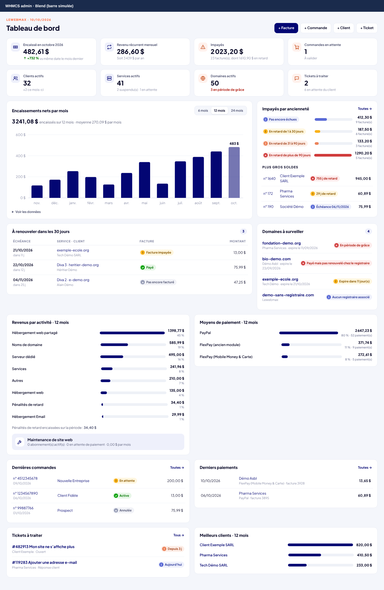
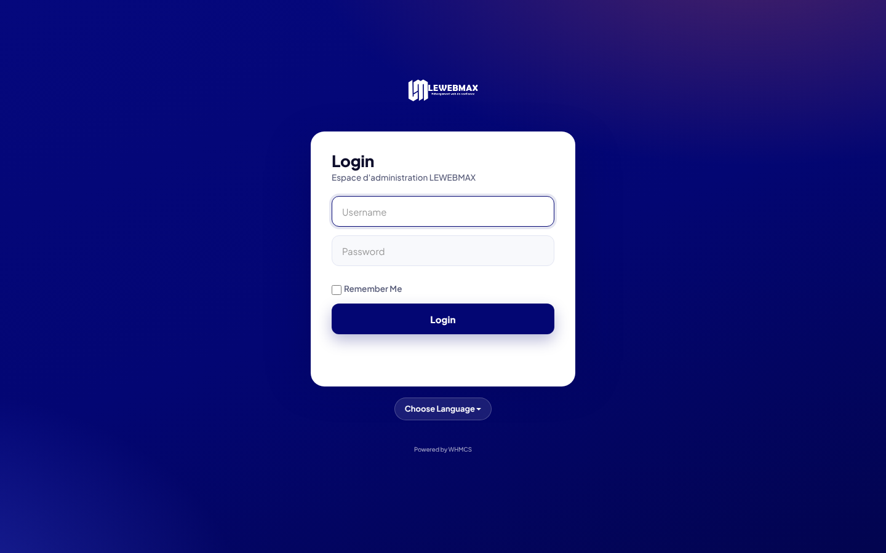
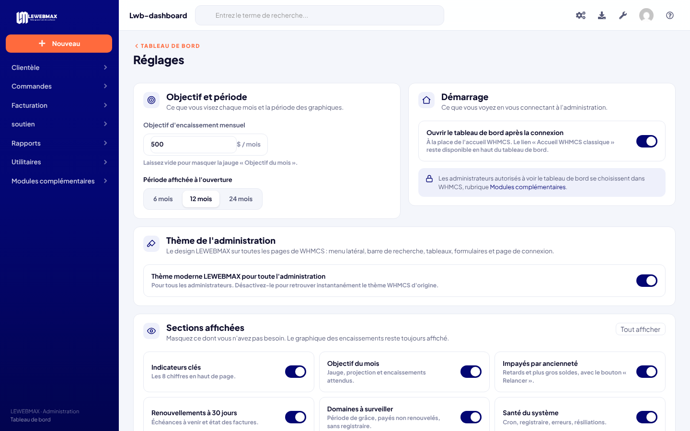
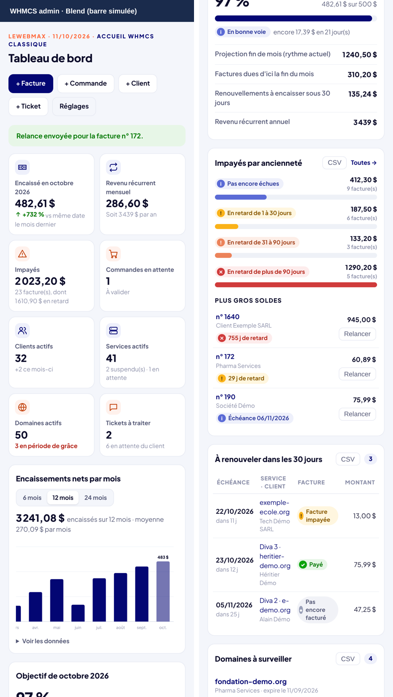

# LWB Admin (Lwb-dashboard)

Tableau de bord **et thème complet** pour l'administration de **n'importe quel WHMCS 8**. Open source (licence MIT), par LEWEBMAX Admin.

Votre nom, votre logo, vos couleurs et votre police se règlent dans la page Réglages. Les montants s'affichent dans la devise par défaut de WHMCS. Les intégrations (FlexPay, crédit du registraire) n'apparaissent que si elles sont utilisées.

- **Le tableau de bord** réunit sur une seule page tout ce qu'il faut suivre au quotidien : argent encaissé, impayés, renouvellements, domaines à risque, commandes et tickets.
- **Le thème « Lwb-admin »** modernise toute l'administration :
  - menu latéral à icônes, aux couleurs de votre marque, et barre de recherche en haut ;
  - menus contextuels épurés ;
  - tableaux, formulaires, onglets, boutons, statuts et fenêtres redessinés ;
  - page de connexion à votre marque (facultatif) ;
  - version mobile avec menu coulissant.



## Outils de travail (1.4)

### File « À faire »

Tout ce qui attend une action, au même endroit : menu latéral › « À faire », avec un compteur.

| Groupe | Actions |
|---|---|
| Urgences système (cron arrêté, crédit du registraire épuisé) | Ouvrir |
| Commandes à valider | **Accepter** (lance l'activation), Ouvrir |
| Services payés non activés | **Activer**, Ouvrir |
| Tickets à répondre | **Répondre** |
| Factures dues sous 3 jours ou en retard depuis moins de 30 jours | **Relancer par e-mail**, **WhatsApp** (message prêt avec le lien de paiement : FlexPay Mobile Money s'il est actif, sinon la facture en ligne), **Copier le lien**, Ouvrir |
| Domaines en danger (grâce, rédemption, payés non renouvelés) | **Prévenir le client**, Ouvrir |
| Actions de modules en échec, demandes de résiliation | Ouvrir |

Chaque élément peut être **reporté** à demain ou de 7 jours. Toutes les actions demandent une confirmation et sont protégées par le jeton de sécurité de WHMCS.

### Centre de notifications

Une cloche dans la barre du haut, avec le nombre de nouveautés, liste les événements des 7 derniers jours :

- nouvelles commandes et paiements reçus ;
- nouveaux tickets et réponses de clients ;
- échecs chez le registraire, erreurs de modules et résiliations.

Les urgences en cours (cron arrêté, crédit épuisé) restent en tête. La liste se met à jour toutes les minutes. Le « lu / non lu » est gardé dans le navigateur.

### Listes intelligentes

Sur les listes de factures, commandes, clients, services, domaines et tickets :

- **filtres en un clic**, par exemple : Impayées, En retard, À valider, Réponse client ;
- **recherches enregistrées** : remplissez « Chercher/Filtrer », puis cliquez sur « Enregistrer la recherche » ;
- **choix des colonnes**, mémorisé pour chaque liste ;
- **en-tête qui reste visible** pendant le défilement ;
- **barre de sélection** qui reprend les actions groupées de WHMCS : marquer payée, relancer, accepter, fermer, etc.

### Actions mobiles et WhatsApp

Sur téléphone, une barre d'actions en bas de l'écran :

- **commande** : Accepter, Client ;
- **ticket** : Répondre, Envoyer ;
- **facture impayée** : WhatsApp, Copier le lien, Paiement reçu.

Sur ordinateur, un bouton WhatsApp apparaît à côté du lien de paiement FlexPay de la facture.

## Thème de l'administration (Lwb-admin)



Le thème s'applique par-dessus le thème WHMCS d'origine (Blend), sans le modifier. Il a été vérifié page par page sur les 239 pages de l'administration WHMCS 8.13 (menus, réglages, rapports, journaux, extensions) :

- il se charge sur toutes les pages de l'administration ;
- un interrupteur dans **Réglages › Thème de l'administration** le désactive instantanément ;
- le bouton à gauche du titre, dans la barre du haut, masque ou affiche le menu de la section, pour travailler en pleine largeur sur les grands tableaux.

### Finitions (1.5)

- **Listes plus compactes** : les boutons Voir / Editer / Supprimer de chaque ligne sont regroupés dans un menu « ⋯ ». La suppression est rangée en bas du menu, en rouge. Les petites images modifier / supprimer sont remplacées par des icônes discrètes.
- **Statuts en pastilles de couleur**, identiques partout : vert (actif, payé), orange (en attente, non payé), rouge (impayé, suspendu, échec), gris (annulé, fermé). Les statuts restés en anglais (Active, Pending…) sont traduits.
- **Montants** sur une seule ligne, alignés à droite.
- **Fiche client** : icônes du thème à la place des anciennes icônes de WHMCS, panneaux sur deux colonnes sur les écrans moyens, et lien « Voir sur la carte » quand l'adresse contient des coordonnées GPS.
- **Panneau de la section masqué par défaut**, puisque ses liens font doublon avec le menu de gauche. Le bouton de la barre du haut le réaffiche (recherche avancée, filtres).
- **Traduction corrigée** : « ticket » au lieu de « billet », « Support » au lieu de « soutien », « Affiliés », « Adresse », « Registraire »… L'extension génère `{dossier admin}/lang/overrides/french.php` à partir de la traduction installée. WHMCS ne touche pas à ce fichier lors des mises à jour, et l'extension le régénère si la traduction de WHMCS change. Les textes que WHMCS écrit en dur en anglais (statuts, tâches, en-têtes) sont traduits à l'affichage.
- **Pages d'erreur** (page introuvable…) dans le design du thème, en français.
- **Listes vides** : message clair, et bouton d'ajout quand la page en propose un.
- **Journal des paiements** : un résumé lisible (montant, téléphone, référence, « Paiement refusé par l'opérateur »…), avec le détail technique repliable.

Ces finitions ne changent que l'affichage : aucune donnée n'est modifiée.

Deux écrans autonomes de WHMCS gardent leur propre design : WHMCS Connect et l'assistant « Getting started ». La page brute « Invalid CSRF Protection Token », affichée par WHMCS sans aucun modèle de page, ne peut pas être habillée.

La page de connexion est habillée par une ligne ajoutée à `login.tpl`. WHMCS remplace ce fichier à chaque mise à jour, et l'extension remet la ligne automatiquement à la connexion suivante. Si vous préférez que l'extension ne touche à aucun fichier de WHMCS, décochez **Réglages › Habiller aussi la page de connexion**.

La mention de copyright de WHMCS reste affichée, comme l'exige la licence.

## Ce qu'affiche le tableau de bord

- **8 indicateurs** :
  - encaissé ce mois, comparé à la même date le mois précédent ;
  - revenu récurrent mensuel ;
  - impayés, avec la part en retard ;
  - commandes en attente ;
  - clients actifs ;
  - services actifs ;
  - domaines actifs, avec ceux en période de grâce ;
  - tickets à traiter.
- **Encaissements nets par mois** sur 6, 12 ou 24 mois, avec info-bulle au survol et tableau des données.
- **Impayés par ancienneté** (pas encore échus, 1–30 j, 31–90 j, plus de 90 j) et plus gros soldes.
- **Renouvellements des 30 prochains jours**, avec l'état de la facture : payée, impayée ou pas encore facturée.
- **Domaines à surveiller** :
  - en période de grâce ou en rédemption ;
  - payés mais pas renouvelés chez le registraire ;
  - expirant dans 15 jours ;
  - sans registraire.
- **Revenus par activité** (catégorie de produits, domaines, pénalités de retard…) et **par moyen de paiement**.
- **Dernières commandes**, **derniers paiements**, **tickets à traiter** et **meilleurs clients**.
- **Objectif du mois** : jauge de progression, projection de fin de mois, factures dues d'ici la fin du mois, renouvellements à encaisser sous 30 jours.
- **Santé du système** :
  - dernier passage du cron et des tâches quotidiennes ;
  - échecs d'enregistrement ou de renouvellement de domaines, avec une alerte dédiée quand le crédit du registraire est épuisé ;
  - erreurs techniques des 7 derniers jours ;
  - services payés mais non activés ;
  - demandes de résiliation ;
  - extrait du journal d'activité.
- **Bouton « Relancer »** sur les plus gros impayés : envoie l'e-mail de relance adapté au retard, au plus une fois par jour et par facture.
- **Export CSV** (compatible Excel) des impayés, des renouvellements et des domaines à surveiller.
- Un **widget** « {votre nom} en un coup d'œil » sur l'accueil de l'administration, avec un bandeau en cas d'alerte urgente. Il n'est proposé qu'aux administrateurs autorisés à voir l'extension.

Chaque ligne renvoie vers la fiche correspondante : client, facture, service, domaine, commande ou ticket. La page s'adapte au mobile.

L'extension ne modifie aucune donnée. Seules exceptions : le bouton « Relancer », qui envoie un e-mail, et la page Réglages. Les deux agissent uniquement à la demande de l'administrateur et sont protégés par le jeton de sécurité de WHMCS. Les graphiques sont en SVG généré côté serveur, sans bibliothèque JavaScript externe.

## Installation

1. Copier le dossier `modules/addons/lwb_dashboard` dans `modules/addons/` de WHMCS.
2. Dans l'administration, aller dans **Configuration › Modules complémentaires**, puis **Activer** sur « LWB Admin ».
3. Choisir les rôles d'administrateur autorisés à voir le tableau de bord.
4. Ouvrir **Modules complémentaires › LWB Admin**, puis **Réglages** : renseigner la marque et activer le thème si vous le souhaitez. Le widget apparaît sur l'accueil de l'administration.

## Réglages

Le bouton **Réglages**, en haut du tableau de bord, ouvre une page dans le même design :



- **Objectif et période** :
  - objectif d'encaissement mensuel ; laissez le champ vide pour masquer la jauge ;
  - période affichée à l'ouverture : 6, 12 ou 24 mois.
- **Démarrage** : ouvre le tableau de bord après la connexion, à la place de l'accueil WHMCS. Le lien « Accueil WHMCS classique » reste disponible.
- **Thème de l'administration** : active ou désactive le thème Lwb-admin pour tous les administrateurs, et choisit d'habiller ou non la page de connexion.
- **Marque** :
  - nom affiché (vide : le nom de la société dans WHMCS), repris dans le widget, le menu et les messages WhatsApp ;
  - logo blanc pour le menu et la page de connexion (vide : le logo de WHMCS) ;
  - couleur principale et couleur d'accent ;
  - police : Plus Jakarta Sans, Inter (Google Fonts) ou la police du système, sans aucun chargement externe ;
  - groupe de produits mis en avant (abonnements et revenu mensuel sous « Revenus par activité »).
- **Sections affichées** : un interrupteur par carte pour masquer ce qui ne sert pas. Quand une carte est masquée, sa voisine prend toute la largeur.

Les administrateurs autorisés se choisissent toujours dans WHMCS (Configuration › Modules complémentaires), comme pour toute extension.

## Compatibilité

- WHMCS 8.x (testé sur 8.13), PHP 7.4 à 8.2.
- Fonctionne avec le thème d'administration par défaut « Blend ». Comme la page est une extension, elle n'est pas touchée par les mises à jour de WHMCS.

## Structure

```
modules/addons/lwb_dashboard/
├── lwb_dashboard.php   configuration, activation, page du module
├── hooks.php           thème, notifications, widget de l'accueil, redirection
├── lib/brand.php       marque, devise, police, registraire, intégration FlexPay
├── lib/data.php        calcul des chiffres (requêtes en lecture seule)
├── lib/health.php      santé du système, objectif et prévisions
├── lib/actions.php     actions (relance, réglages, file « À faire ») avec jeton CSRF WHMCS
├── lib/todo.php        file « À faire », liens WhatsApp et de paiement
├── lib/notify.php      centre de notifications
├── lib/view.php        affichage HTML et graphiques SVG
├── lib/lang.php        corrections de la traduction française (overrides)
└── assets/             styles et info-bulles
```

## Aperçu mobile



Les captures utilisent des données d'exemple.

## Historique

- **2.0** : utilisable sur n'importe quel WHMCS. Nom, logo, couleurs et police réglables (carte « Marque »). Montants dans la devise par défaut de WHMCS. Registraire détecté automatiquement. FlexPay facultatif. Groupe de produits mis en avant au choix. Option pour ne pas modifier `login.tpl`. Widget réservé aux rôles autorisés. Plus aucun chargement de Google Fonts écrit en dur.
- **1.5** : finitions sur toute l'administration : menu « ⋯ » pour les actions de ligne, statuts en pastilles, montants alignés, fiche client modernisée, panneau de section masqué par défaut, traduction corrigée (ticket, Support…), pages d'erreur, listes vides et journal des paiements lisibles.
- **1.4** : file « À faire » avec actions en un clic, centre de notifications, listes intelligentes (filtres, recherches enregistrées, colonnes, en-tête fixe, barre de sélection), actions mobiles et WhatsApp ; correction du bouton « + Facture » (jeton de sécurité manquant).
- **1.3.1** : passe complète sur les 239 pages de l'administration ; menus latéraux plus fins, bouton pour masquer le menu de la section (mémorisé), entrée « Configuration » dans le menu, anciennes icônes WHMCS harmonisées, page de connexion ajustée sur mobile.
- **1.3** : thème Lwb-admin pour toute l'administration et la page de connexion, activable dans les Réglages.
- **1.2** : nouvelle page Réglages dans le design du tableau de bord (interrupteurs, choix de la période, sections à afficher). Les champs de l'ancienne page de configuration WHMCS sont supprimés.
- **1.1** :
  - réglages : objectif, période, page d'accueil ;
  - objectif du mois et prévisions ;
  - santé du système ;
  - bouton « Relancer » ;
  - exports CSV ;
  - affichage de toutes les échéances à 30 jours ;
  - alerte urgente dans le widget.
- **1.0** : première version.
